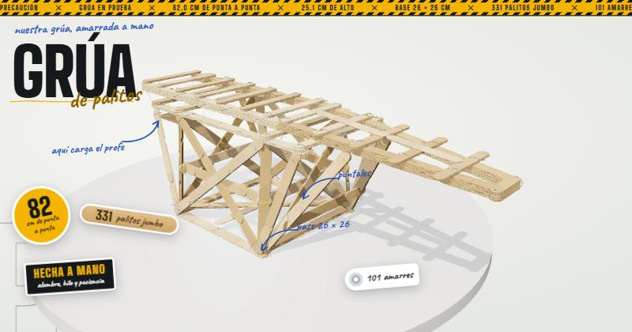

# Grúa de palitos · modelo 3D

Modelo 3D interactivo de nuestra grúa hecha con palitos jumbo, alambre e hilo.

**Ver en línea:** https://miguelin777.github.io/grua-palitos-3d/

## Medidas reales

| | |
|---|---|
| Largo total | 82 cm |
| Alto | 25 cm |
| Ancho (marco superior) | 22 cm |
| Base | 26 × 26 cm |

## Qué se puede hacer

- Girar, acercar y ver la grúa desde cualquier lado (también en celular).
- Ver la grúa armándose pieza por pieza.
- Seguir un **recorrido guiado** de 9 pasos para presentarla en clase.
- Cambiar de vista: madera, plano técnico, rayos X (amarres) y esfuerzos.
- **Prueba de carga**: poner peso en la charola (donde el profe pone la carga, a ~10 cm de la base) y ver el centro de gravedad, el factor de seguridad y cuánto aguanta antes de voltearse.
- Simular, como extra, pesas colgadas de la pluma con su **tabla de cargas**.
- Ver la lista de materiales y los datos de cada pieza.
- Stickers que se pueden arrastrar y notas a mano que señalan las partes.
- Guardar una imagen, modo presentación y pantalla completa.

Atajos: `1`–`4` vistas · `P` presentación · `Esc` salir · `←` `→` en el recorrido.

Si el proyector o la compu van lentos, abre la página con `?quieto` al final del link para quitar las animaciones.

Las masas salen del propio modelo (3.2 g por palito). Los límites de resistencia son una estimación didáctica.

Hecho con [three.js](https://threejs.org/), en un solo archivo `index.html`.
